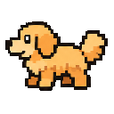
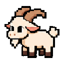
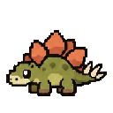

<div align="center">


# DIYPets

### **Make your own desktop pet — in pure Rust.**

A tiny, blazing-fast, cross-platform desktop mascot engine with **Multi-Pet Herd Mode**, a built-in **2D/SVG Pet Creator Studio**, original defringed animal packs, and **lazy-loaded classic eSheep XML support**.

[](https://crates.io/crates/diypets)
[](https://crates.io/crates/diypets)
[](https://github.com/smresponsibilities/diypets/actions)
[](LICENSE-MIT)
[](#-download--install)

**[Download Release](https://github.com/smresponsibilities/diypets/releases)** · **[Install via Cargo](#option-2-install-via-cargo-cratesio)** · **[Multi-Pet Herd Mode](#-multi-pet-herd-mode)** · **[Studio V2 & SVG Import](#-diypets-studio-v2-make-your-own-pet)** · **[AI Agent CLI](AGENT_PET_GUIDE.md)**

</div>

---

## Meet the "Made by SM" Originals

5 original pixel-verified mascots—plus **27+ classic eSheep community packs** downloadable on demand in one click inside Settings.

| Highland Cow | Dog | Polar Bear | Goat | Stegosaurus |
| :---: | :---: | :---: | :---: | :---: |
|  |  |  |  |  |

---

## Why DIYPets?

| Feature | **DIYPets (Rust)** | Electron / WebView Pets | Shimeji-ee (Java) | Classic eSheep (.NET) |
| :--- | :---: | :---: | :---: | :---: |
| **Native binary (zero runtime needed)** | **Yes** | No (Chromium) | No (JRE) | No (.NET) |
| **Idle RAM footprint** | **~8-15 MB** | 80-180 MB+ | 60-120 MB | ~25 MB |
| **Cross-platform (Win / macOS / Linux)** | **Yes** | Yes | Partial | Windows only |
| **Multi-Pet Herd Mode (up to 8 pets)** | **Yes** | Varies | Yes | Yes |
| **Built-in 2D/SVG Studio + Custom Anims** | **Yes** | No | No | External C# tool |
| **AI Agent SVG-to-Pet CLI (--from-svg)** | **Yes** | No | No | No |
| **Classic eSheep XML compatibility** | **Yes (lazy-loaded)** | No | No | Yes |
| **Start on Login & System Tray** | **Yes** | Varies | No | Yes |
| **100% Free & Open Source** | **MIT / Apache-2.0** | Varies | Mixed | Mixed |

---

## Download & Install

### Option 1: Pre-Built Binaries (Easiest — No Rust Needed)
1. Open **[GitHub Releases](https://github.com/smresponsibilities/diypets/releases)** and download your OS archive:
   - **Windows:** diypets-windows-x86_64.zip
   - **macOS (Apple Silicon):** diypets-macos-arm64.tar.gz
   - **Linux:** diypets-linux-x86_64.tar.gz
2. Unzip and double-click **diypets** (diypets.exe on Windows).
3. Your mascot drops onto your taskbar (zero terminal popup) and adds an icon to your **system tray**.

### Option 2: Install via Cargo (crates.io)
Requires [Rust 1.85+](https://rustup.rs/):
```bash
cargo install diypets
diypets
```
This installs all three native binaries globally:
- diypets — runs your desktop pet herd + system tray menu
- diypets-settings — instant 2-row pet gallery, Herd manager, lazy pack downloader & autostart
- diypets-creator — **DIYPets Studio V2** GUI & headless AI Agent CLI

### Option 3: Build From Source
```bash
git clone https://github.com/smresponsibilities/diypets.git
cd diypets
cargo run --release
```
<details>
<summary><strong>Linux (Ubuntu / Debian) build dependencies</strong></summary>

```bash
sudo apt-get update
sudo apt-get install -y libgtk-3-dev libayatana-appindicator3-dev libxdo-dev \
  libxcb-render0-dev libxcb-shape0-dev libxcb-xfixes0-dev libxkbcommon-dev pkg-config
```
</details>

---

## Using DIYPets

### Multi-Pet Herd Mode
Run up to **8 pets simultaneously**—mix Highland Cow, Dog, Sky Bird, Emerald Snake, or classic eSheep together:
- **From Settings (diypets-settings):** Click **+ Add** on any installed pet card to spawn it alongside your current pets. Manage or dismiss extras anytime from the **Active Herd** bar at the top.
- **From System Tray:** Right-click the tray icon -> **Add Another Pet (+1)**, **Remove Extra Pet (-1)**, or **Sleep All**.

### System Tray & Desktop Interaction
- **Drag & Toss:** Grab any pet and flick it across your monitor—it falls, lands, and resumes roaming.
- **Window Ledges:** Pets walk across your taskbar and perch on open application windows (toggle via **Climb Windows**).
- **Start on Login:** Toggle **Start on Login** in Settings or the System Tray (native Windows Registry / macOS LaunchAgent / Linux XDG autostart).

### Fast 2-Row Settings & Lazy Pack Downloads
- **Row 1 — Made by SM:** Original roster + any pets you create or import.
- **Row 2 — eSheep:** 27+ classic community packs. Click any Get (XXX KB) card to download, validate, and activate on demand. Right-click downloaded packs to remove them.
- **Import Pet (.xml):** Install any shared diypets or eSheep XML file in one click.

---

## DIYPets Studio V2 (Make Your Own Pet)

Launch from the tray menu, Settings (**+ Create Pet**), or diypets-creator:

- **5 Creature Archetypes & Templates:** **Quadruped (Cat)**, **Biped (Buddy)**, **Bird / Flyer (Flapping Wings)**, **Crawler (Sinusoidal Slither Snake)**, and **Swimmer (Koi Fish)**.
- **Unlimited Extra Parts & Seamless Outlines:** Add Wings, Tails, Ears, Extra Limbs, or Props with 2.5D far-limb shading and unified outer silhouette outlining (zero cut-out shoulder seams).
- **5 Auto-Swapped Face Expressions:** Draw **Neutral, Blink, Happy, Sleep, and Surprised** overlays once—the exporter swaps them automatically across desktop states.
- **Custom Keyframe Animations:** Build Hop, Wiggle Dance, or custom multi-frame actions with travel speed and probability weights.
- **Pure-Rust 2D SVG Importer:** Click **Import 2D SVG** to automatically split semantic <g id="body|wing|tail|front_leg|back_leg|face"> layers (or untagged shapes) into a rigged pet.
- **Headless AI Agent CLI:** Claude Code, Cursor, Codex, and Gemini agents can build and activate pets in one command (see [AGENT_PET_GUIDE.md](AGENT_PET_GUIDE.md)):
```bash
diypets-creator --from-svg bird.svg --name "Sky Bird" --archetype bird --author "SM" --activate
```

---

## Contributing & Community

Love DIYPets? Give the repo a **Star** to help others discover it!

- **Found a bug?** [Open a Bug Report](https://github.com/smresponsibilities/diypets/issues/new?template=bug_report.yml)
- **Have an idea?** [Request a Feature](https://github.com/smresponsibilities/diypets/issues/new?template=feature_request.yml)
- **Made a pet?** [Submit a Community Pet Pack](https://github.com/smresponsibilities/diypets/issues/new?template=submit_pet_pack.yml)
- **Want to code?** Read [CONTRIBUTING.md](CONTRIBUTING.md) and check [ROADMAP.md](ROADMAP.md) and [TICKETS.md](TICKETS.md).

---

## Credits & Acknowledgments
- **Made by SM:** Original mascot art (Highland Cow, Dog, Polar Bear, Goat, Stegosaurus), DIYPets Studio V2, and Rust engine by SM (smresponsibilities).
- **eSheep Format & Classic Packs:** Credit to Adriano Petrucci ([Adrianotiger/desktopPet](https://github.com/Adrianotiger/desktopPet), MIT License), the original 1995 *Stray Sheep* desktop buddy, and individual pack authors credited in Settings and [CREDITS.md](CREDITS.md).

## License
Dual-licensed under [MIT](LICENSE-MIT) or [Apache-2.0](LICENSE-APACHE).