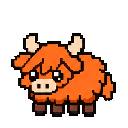

<div align="center">


# DIYPets

**Make your own desktop pet — in pure Rust.**

A lightweight (~7.8 MB RAM), cross-platform desktop mascot engine with **Multi-Pet Herd Mode**, **Play Mode**, a **6-tool MCP server** for AI coding agents, a built-in **2D/SVG Pet Creator Studio**, and lazy-loaded classic **eSheep XML** support.

[](https://crates.io/crates/diypets)
[](https://crates.io/crates/diypets)
[](https://github.com/smresponsibilities/diypets/actions/workflows/ci.yml)
[](LICENSE-MIT)
[](#install)

[Interactive Demo](https://shivammahajan.com/diypets) · [Install](#install) · [Play Mode & Herd](#play-mode--herd) · [MCP & CLI](#ai-agent-mcp--cli) · [Studio V4](#diypets-studio-v4)

<!-- AUTO:STATS:START -->
> **Latest:** 0.3.0 · **5 Made by SM originals** + **27+ on-demand eSheep packs** · **~7.8 MB RAM** · **stdio & HTTP MCP**
<!-- AUTO:STATS:END -->

</div>

<<<<<<< HEAD
=======

<!-- AUTO:STATS:START -->
> **Latest release:** `v0.3.0` · **5 Made by SM originals** + **27+ on-demand eSheep packs** · **~7.8 MB RAM** · **MCP API on `:3721`**
<!-- AUTO:STATS:END -->

>>>>>>> 7ac6297889f6332b765c229238fc0393c86acce2
---

## Meet the Originals

Five pixel-verified mascots bundled out of the box, plus 27+ classic eSheep community packs downloadable on demand inside Settings.

<p align="center">
  &nbsp;&nbsp;
  &nbsp;&nbsp;
  &nbsp;&nbsp;
  &nbsp;&nbsp;
  
</p>

## Why DIYPets?

| Feature | DIYPets (Rust) | Electron Pets | Shimeji-ee (Java) | Classic eSheep (.NET) |
| :--- | :---: | :---: | :---: | :---: |
| Native binary (zero runtime) | **Yes** | No | No | No |
| Idle RAM footprint | **~8 MB** | 80–180 MB+ | 60–120 MB | ~25 MB |
| Windows / macOS / Linux | **Yes** | Yes | Partial | Windows only |
| Multi-Pet Herd (per-pet size & speed) | **Up to 8** | Varies | Yes | Yes |
| Built-in 2D/SVG Studio + RotSprite | **Yes** | No | No | External |
| Native stdio & HTTP MCP for AI Agents | **Yes (6 tools)** | No | No | No |
| Classic eSheep XML compatibility | **Yes** | No | No | Yes |
| Fullscreen Auto-Hide & Quiet Mode | **Yes** | Varies | No | No |

## Install

### 1-Line Install (No Rust Needed)

**Windows (PowerShell):**
```powershell
irm https://raw.githubusercontent.com/smresponsibilities/diypets/main/install.ps1 | iex
```

**macOS / Linux:**
```bash
curl -fsSL https://raw.githubusercontent.com/smresponsibilities/diypets/main/install.sh | bash
```

Or grab a pre-built archive from [GitHub Releases](https://github.com/smresponsibilities/diypets/releases/latest).

### Cargo (crates.io)
```bash
cargo install diypets
diypets
```

Installs three native binaries:
* diypets — desktop mascot engine, system tray, Play Mode & MCP server
* diypets-settings — tabbed Pet Gallery, Active Herd manager & lazy eSheep downloader
* diypets-creator — DIYPets Studio V4 GUI & headless SVG-to-Pet CLI

## Play Mode & Herd

* **Multi-Pet Herd Mode:** Run up to 8 pets at once with independent size and speed sliders per pet. Pets greet each other with hops and pixel hearts when they meet.
* **Play Mode:** Right-click any pet (or tray menu) → **Drop Bouncy Ball** so your herd chases and kicks it across the taskbar, or toggle **Follow Cursor**.
* **Physics & Window Ledges:** Grab and toss pets onto open app titlebars—complete with bottom-anchored **Squash & Stretch**, idle breathing, and moving-window riding.
* **Fullscreen Auto-Hide & Quiet Mode:** Automatically hides pets and pauses physics during fullscreen games, videos, or screen shares.

## AI Agent MCP & CLI

Connect Claude Desktop, Cursor, or Claude Code directly over native **stdio MCP**:

```json
{
  "mcpServers": {
    "diypets": {
      "command": "diypets",
      "args": ["mcp"]
    }
  }
}
```

Exposes **6 MCP tools** (
eact_pet, say, drop_ball, spawn_pet, set_follow_cursor, list_herd) plus a local HTTP server on http://127.0.0.1:3721 and instant CLI shortcuts:

```bash
diypets say "Build passed!"
diypets ball
diypets react --mood happy --text "PR merged!"
```

## DIYPets Studio V4

Launch via **DIYPets Studio** in the tray or diypets-creator:
* **Draw & Rig:** 128×128 pixel board with **Select (M)** (Copy/Paste/Flip H/Del), **1-Click Auto-Outline**, **Mirror X**, **4× EPX RotSprite** limb rotation, and **Live Ghost Rigging**.
* **Animate & Test:** Visual keyframe filmstrip with **Onion Skinning** (Prev Red / Next Blue), **Sprite Sheet Slicer**, and a **6. Sandbox** live physics playground.
* **2D SVG Auto-Rigger & CLI:**
```bash
diypets-creator --from-svg bird.svg --name "Sky Bird" --archetype bird --author "SM" --activate
```

## License

Dual-licensed under [MIT](LICENSE-MIT) or [Apache-2.0](LICENSE-APACHE). Classic eSheep format credits in [CREDITS.md](CREDITS.md).