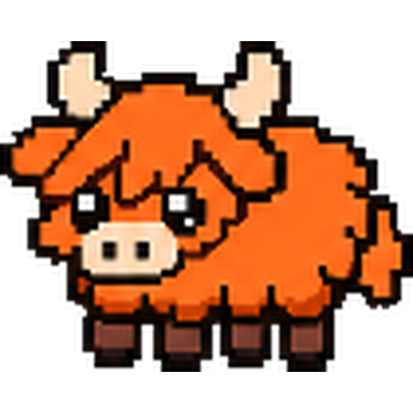

<div align="center">
  
  <h1>DIYPets</h1>
  <p><strong>~7.8 MB RAM cross-platform desktop mascot engine in pure Rust — with Multi-Pet Herd Mode, native Claude/Cursor MCP integration, and a built-in 2D/SVG Pet Studio.</strong></p>

  <p>
    <a href="https://crates.io/crates/diypets"></a>
    <a href="https://github.com/smresponsibilities/diypets/actions"></a>
    <a href="https://shivammahajan.com/diypets/"></a>
    <a href="#license"></a>
  </p>

  <p>
    <a href="https://shivammahajan.com/diypets/">Live Browser Playground</a> ·
    <a href="#quick-install">Quick Install</a> ·
    <a href="#mcp-ai-agent-integration">Claude / Cursor MCP</a> ·
    <a href="#diypets-studio">Pet Studio</a> ·
    <a href="CONTRIBUTING.md">Contribute</a>
  </p>

  
</div>

---

## Why DIYPets?

Most desktop pets require a heavy Java runtime, an Electron/WebView wrapper, or lock you into a single stationary sprite. **DIYPets** compiles to a single native Rust binary with zero runtime dependencies:

- **Tiny Footprint:** ~7.8 MB idle RAM using native Win32 `UpdateLayeredWindow`, macOS Cocoa, and Linux X11/Wayland per-pixel transparency.
- **Multi-Pet Herd Mode:** Run up to 8 pets at once with independent sizes, speeds, window-ledge climbing, squash-and-stretch physics, and bouncy-ball play mode.
- **Native AI Agent MCP Server:** Connect Claude Desktop, Cursor, or Claude Code via `diypets mcp` so coding agents can celebrate passing builds, drop toys, or spawn pets live on your desktop.
- **Built-in 2D/SVG Studio (`diypets-creator`):** Paint pixel art, import SVGs with automatic limb splitting, preview **4x EPX RotSprite** rotation, and export standalone `deskpet.xml` packs.
- **Open eSheep XML Format:** Ships with 5 original mascots and lazy-loads 27+ classic community eSheep packs on demand.

---

## Quick Install

### Windows (PowerShell)
```powershell
irm [https://raw.githubusercontent.com/smresponsibilities/diypets/main/install.ps1](https://raw.githubusercontent.com/smresponsibilities/diypets/main/install.ps1) | iex
```

### macOS & Linux
```bash
curl -fsSL [https://raw.githubusercontent.com/smresponsibilities/diypets/main/install.sh](https://raw.githubusercontent.com/smresponsibilities/diypets/main/install.sh) | bash
```

### Cargo (Any Platform)
```bash
cargo install diypets
diypets
```

---

## CLI & Diagnostics

```bash
diypets                       # Launch desktop mascot herd
diypets say "Build passed!"   # Trigger an on-screen speech bubble
diypets mcp                   # Start stdio MCP server for AI agents
diypets doctor                # Verify config, logs, herd, and build fingerprint
diypets --version             # Print version, git hash, and target triple
diypets-settings              # Open GUI settings & herd manager
diypets-creator               # Open 2D/SVG Pet Studio
```

---

## MCP AI Agent Integration

Add DIYPets to **Claude Desktop**, **Cursor**, or **Claude Code** (`mcp.json`):

```json
{
  "mcpServers": {
    "diypets": {
      "command": "diypets",
      "args": ["mcp"]
    }
  }
}
```

Exposed tools: `pet_say`, `pet_react`, `pet_drop_ball`, `pet_spawn`, `pet_set_follow_cursor`, and `pet_status`.

---

## Contributing

First-time Rust and pixel-art contributors are welcome! See [`CONTRIBUTING.md`](CONTRIBUTING.md) and [`TICKETS.md`](TICKETS.md) for labeled **Good First Issues**, **Medium Features**, and our automated GIF visual validation workflow.

## License

Dual-licensed under **MIT** or **Apache-2.0** at your option.
